<p align="center">
  
</p>

<h1 align="center">FDS Library Swapper</h1>

<p align="center">
  A Figma plugin that re-points the variables (and, optionally, styles) used by a component
  from one brand library to another, matched by token name and type. No library swap, no
  duplicated components, no copied values.
</p>

<p align="center">
  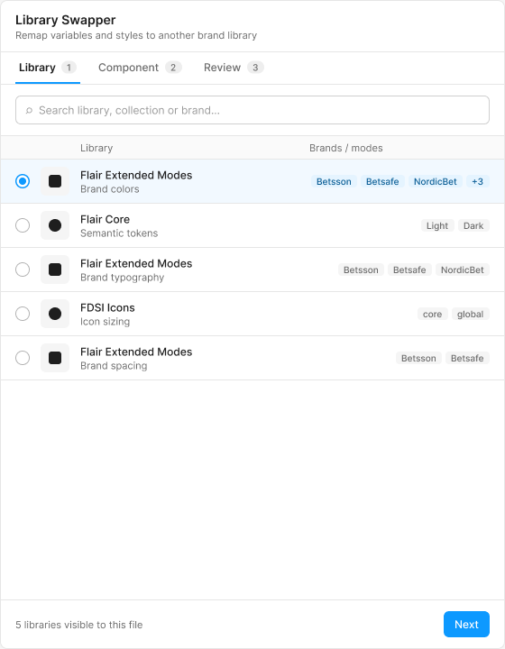
  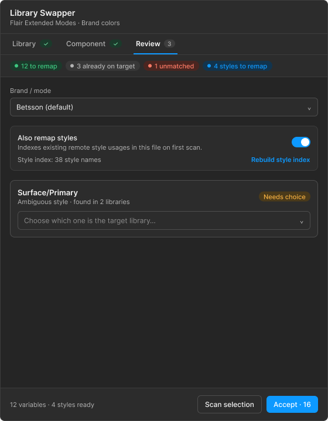
</p>

## Contents

- [What it does](#what-it-does)
- [Quick start](#quick-start)
- [How to use the plugin](#how-to-use-the-plugin)
- [How it works](#how-it-works)
  - [Scan: matching variables](#scan-matching-variables)
  - [Apply: rebinding and mode pinning](#apply-rebinding-and-mode-pinning)
  - [Style remapping](#style-remapping-optional)
  - [Architecture and messages](#architecture-and-messages)
- [Light and dark theme](#light-and-dark-theme)
- [Requirements](#requirements)
- [Known limitations](#known-limitations)
- [Development](#development)
- [Project layout](#project-layout)

## What it does

Your file uses Library A's collection, for example mode `betsson`. A designer wants one
component to preview or ship as Library B's collection, for example mode `starcasino`,
without swapping the whole file's library and without duplicating the component.

The plugin walks the selection (including nested instance overrides), finds every bound
variable, looks up the token with the **same name and type** in the target library and
rebinds to it. It also pins the root layer to the brand mode you pick.

- Matching is by **variable name and type**, so no mapping table is needed.
- It never changes the file's library subscriptions and never copies values.
- Anything it cannot match is left untouched and listed in the report. A run is never
  all-or-nothing.

## Quick start

```bash
npm install
npm run build
```

In the Figma desktop app: **Plugins → Development → Import plugin from manifest…** and
select [`manifest.json`](manifest.json).

Before running, make sure the target library is **enabled in the file's Assets panel**
(see [Requirements](#requirements)).

## How to use the plugin

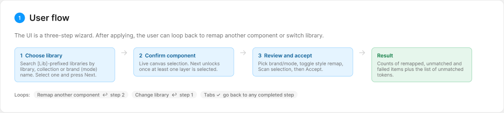

The UI is a three-step wizard. Completed steps get a check mark and can be clicked to go
back.

### 1. Choose the target library

Pick the library the component should resolve from after the remap.

- Only libraries whose name starts with `[Lib]` are listed.
- The search box matches the library name **or any of its brand/mode names**. Typing a
  brand surfaces the library it lives in.
- Modes are prefetched once per library at this step.


### 2. Confirm the component

Select the layer or component on the canvas. The selection card updates live, with no
manual refresh. Click **Next** once something is selected.

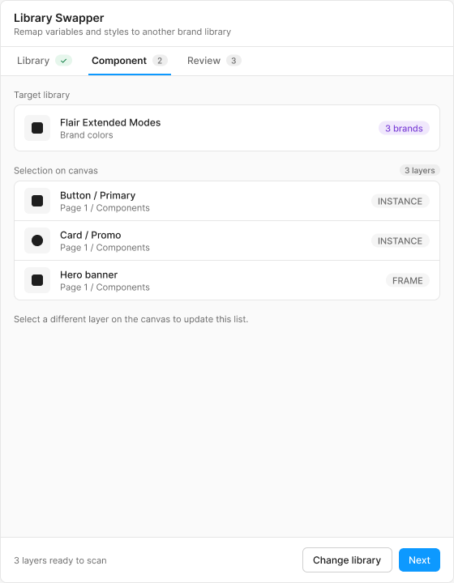

### 3. Review and accept

1. Choose the **Brand / mode** to pin.
2. Optionally turn on **Also remap styles** (see [Style remapping](#style-remapping-optional)).
3. Click **Scan selection**. The summary chips show how many tokens will be remapped,
   are already on the target, or are unmatched.
4. Resolve any **ambiguous styles** by picking the right library from the dropdown.
5. Click **Accept** to apply.

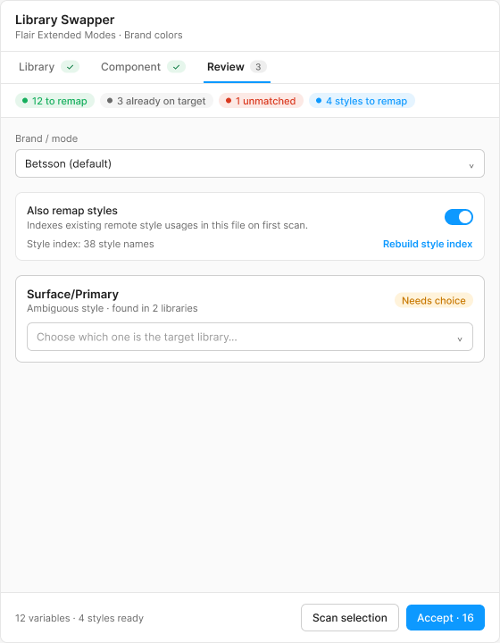

### Result

The result card reports what was remapped, what was left alone and what failed. Unmatched
token names are listed so you can fix them in the library. Use **Remap another component**
to go back to step 2 with the same library, or **Change library** to return to step 1.
Undo with `⌘Z` in Figma.

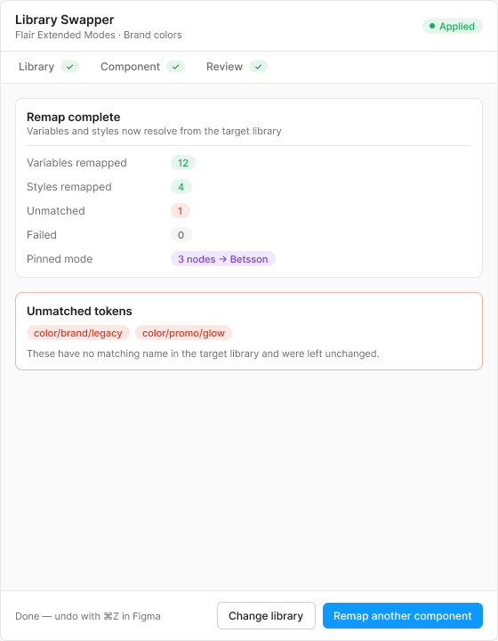

> The screens in this README are the Figma designs the UI was built from.

## How it works

### Scan: matching variables

Scan is read-only. It builds a plan and shows it as chips in step 3.

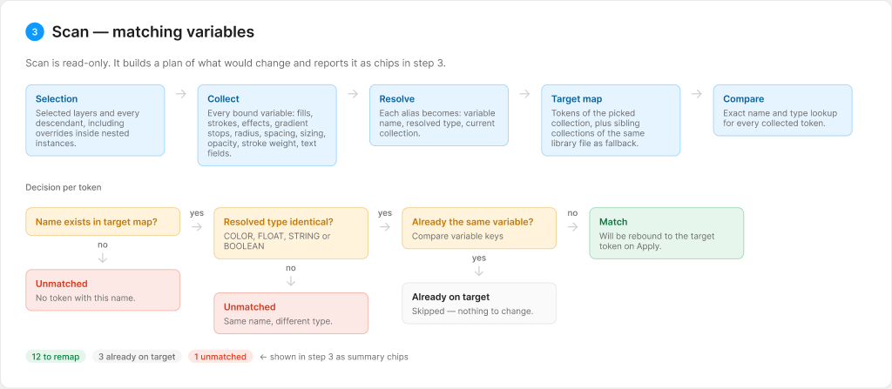

1. Walk the selection and every descendant, including overrides inside nested instances.
2. Collect every bound variable: fills, strokes, effects (including gradient color
   stops), corner radius, spacing and padding, sizing, opacity, stroke weight, typography
   fields and bound text content.
3. Resolve each alias to variable name, resolved type and current collection.
4. Build the target token map from the picked collection plus any **sibling collections in
   the same library file** (for example a shared `ref/primitives` collection), so shared
   reference tokens are not reported as unmatched just because of which collection they
   live in.
5. Compare each token by exact name and type.

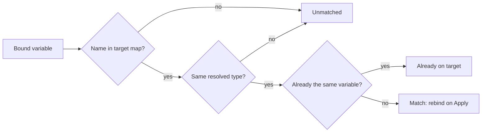

### Apply: rebinding and mode pinning

Apply only touches items with status **Match**.

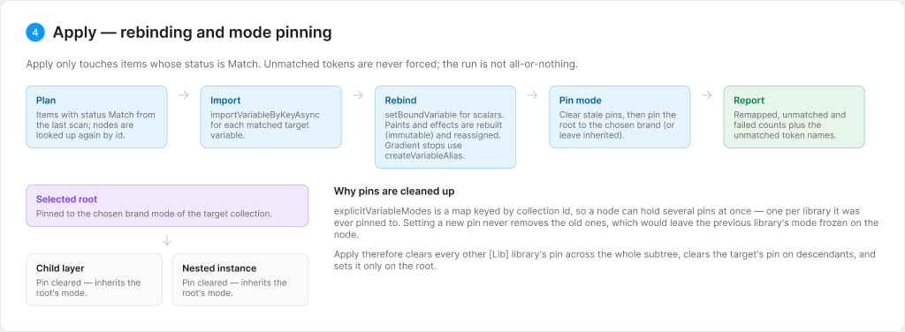

- Matched variables are imported with `importVariableByKeyAsync`.
- Each property is rebound with `setBoundVariable`, `setBoundVariableForPaint` or
  `setBoundVariableForEffect`. Gradient stops are rebuilt manually with
  `createVariableAlias` and the whole paint array is reassigned, because paints and
  effects are immutable objects.
- Unmatched tokens are left untouched and listed in the result.

**Stale mode pins.** Figma's `explicitVariableModes` is a map keyed by collection ID, so a
node can carry several pins at once, one per `[Lib]` library it was ever pinned to.
Setting a new pin never removes the old ones, which would leave the previous library's mode
frozen on the node and give a mixed appearance. Every Apply therefore:

1. clears every other managed `[Lib]` library's pin across the whole subtree,
2. clears the target library's pin on non-root descendants (they inherit from the root),
3. pins only the **root** to the chosen brand mode.

### Style remapping (optional)

Figma's Plugin API has **no library-browsing API for styles**, and style objects do not
expose which library they came from. Style remapping therefore works under one condition:

> The target library's equivalent style must **already be used somewhere in this document**
> (any page), for example on a reference or swatch page.

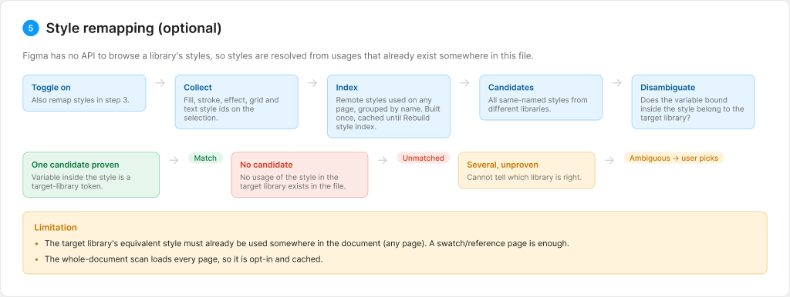

When enabled, the plugin indexes every remote style used in the document. It disambiguates
same-named styles from different libraries by checking which variable is bound **inside**
each style against the target library's variable keys.

| Candidates found | Result |
| --- | --- |
| One, proven by its bound variable | Match |
| None | Unmatched |
| Several, cannot tell which | **Ambiguous**: you pick, the plugin never guesses |

The whole-document scan loads every page, so it is opt-in and cached until you click
**Rebuild style index**.

### Architecture and messages

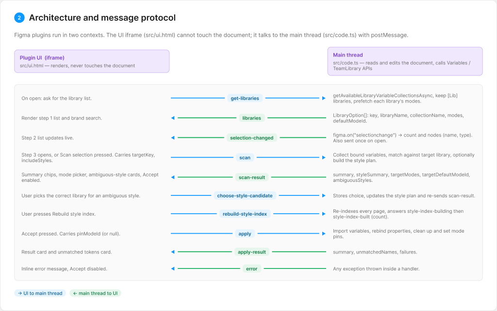

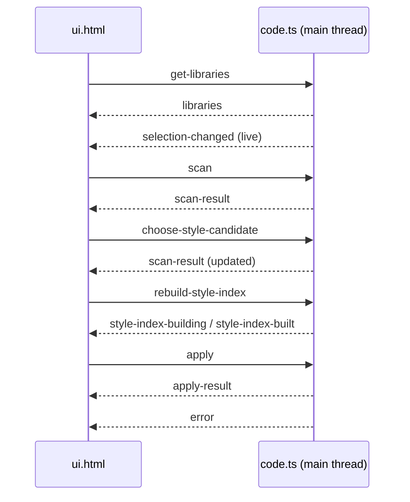

## Light and dark theme

The plugin opens with `themeColors: true`, so Figma adds a `figma-dark` or `figma-light`
class to the UI and the CSS variables switch with the editor theme. There is no setting
to change.

<p>
  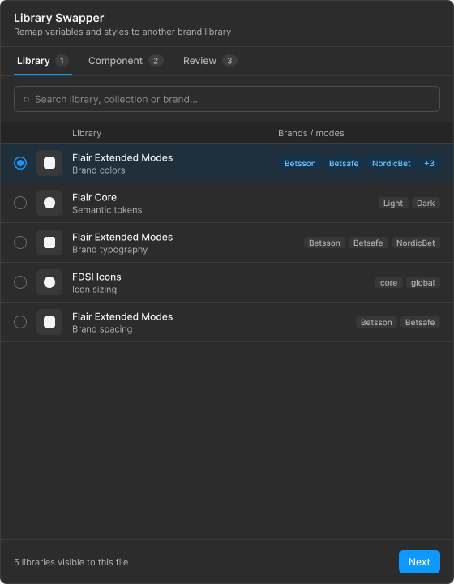
  
</p>

## Requirements

- The target library must already be **enabled in the file's Assets panel**, with its
  **Variables** toggle on (separate from the components and styles toggle). The plugin only
  lists libraries Figma has made available to the file and does not subscribe files to
  new libraries.
- Token names must be identical across the libraries.
- Library names must start with `[Lib]` (see `LIBRARY_PREFIX` in
  [`src/code.ts`](src/code.ts)).
- Manifest: `permissions: ["teamlibrary"]` and `documentAccess: "dynamic-page"`.

## Known limitations

- Style remapping needs an existing usage of the target style in the file. This is a
  Figma platform limit.
- Image paints have no bindable color.
- Per-character text variable bindings (mixed bindings within one text range) are not
  handled, only whole-node text bindings.
- If the selection is edited significantly between **Scan** and **Apply**, node lookups
  may fail for deleted nodes. These are reported as failures.
- Imports run across several `await` boundaries, so very large selections may be recorded
  as more than one undo step.

## Development

```bash
npm run build       # bundle src/code.ts to dist/code.js
npm run watch       # rebuild on change
npm run typecheck   # tsc --noEmit
```

To publish as an org-private plugin (Organization plan), add an `"id"` to
[`manifest.json`](manifest.json) once the plugin listing exists in the Figma admin console,
then publish from the desktop app. Use [`assets/icon-ls-128.png`](assets/icon-ls-128.png)
as the plugin icon (the manifest has no icon field).

## Project layout

| Path | Purpose |
| --- | --- |
| `manifest.json` | Plugin manifest |
| `src/code.ts` | Main-thread logic: scanning, matching, importing, rebinding |
| `src/ui.html` | Plugin UI (wizard, scan preview, apply, light and dark theme) |
| `assets/` | App icon (SVG and 128 px PNG) |
| `docs/images/` | Screens and diagrams used in this README |
